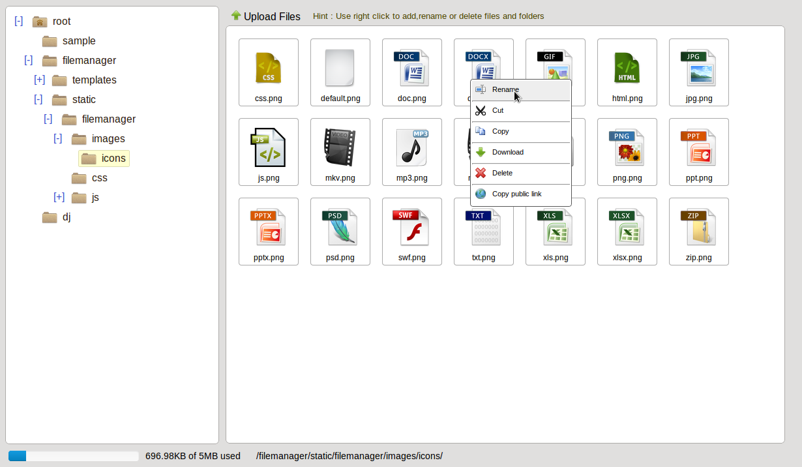

Filemanager
===========

[](https://github.com/TalanaHRM/lib-django-filemanager/releases)


[](LICENCE)

Filemanager is a simple Django app to browse files on server.
You can also integrate this filemanager with CKEditor.

This is the Talana-maintained fork of
[IMGIITRoorkee/django-filemanager](https://github.com/IMGIITRoorkee/django-filemanager). See
[CHANGELOG.md](CHANGELOG.md) for what changed.

Requirements
------------

* Python 3.8 or newer. Tested with 3.10 and 3.12.
* Django 4.2 or newer. Tested with 4.2, 5.2 and 6.1.
* [Pillow](https://pypi.org/project/Pillow/) for thumbnails. Tested with 11.2 and 13.0.
* [python-magic](https://pypi.org/project/python-magic/) and the `libmagic` system library to check the type of
  uploaded files: `apt install libmagic1` on Debian and Ubuntu, `brew install libmagic` on macOS.
* `STATIC_URL` and static files served (`django.contrib.staticfiles`), for the CSS, JavaScript and icons of the app.

Screenshot
----------



Quick start
-----------

The package is not published on PyPI. The name `django-filemanager` on PyPI belongs to a different project, so
**do not** run `pip install django-filemanager`. Install a tagged release from GitHub instead, pinned to a tag
or, better, to a commit:

<pre>
pip install "django-filemanager @ git+https://github.com/TalanaHRM/lib-django-filemanager.git@v1.0.1"
</pre>

The same line works in a `requirements.txt` file.

Add `"filemanager"` to your `INSTALLED_APPS` setting like this:
```python
INSTALLED_APPS = (
    ...
    'django.contrib.staticfiles',
    'filemanager',
)
```

Usage
-----

* As a filemanager : To upload files on server by a user to a directory and let him manage his directory by adding,
renaming and deleting files and folders inside it.

* Integrating it with CKEditor for the functionality of "Browse Server".


As a filemanager
----------------

In `urls.py` of your app to make filemanager run at url `/abc/`.
```python
from django.urls import re_path

from filemanager import path_end

from .views import view

urlpatterns = [
    re_path(r'^abc/' + path_end, view, name='view'),
]
```

Then write the view in `views.py` of your app:
```python
from django.conf import settings
from django.contrib.auth.decorators import permission_required

from filemanager import FileManager


@permission_required('myapp.manage_files')
def view(request, path):
    extensions = ['html', 'htm', 'zip', 'py', 'css', 'js', 'jpeg', 'jpg', 'png']
    fm = FileManager(settings.MEDIA_ROOT, extensions=extensions)
    return fm.render(request, path)
```
And it is done, you can find the tests of the app in the `tests` directory.

The library does not check who the user is. Protect the view yourself, as above, because anyone who can reach it
can upload, rename, move and delete files inside `basepath`. Every path that points outside `basepath` is
rejected, including symbolic links that leave it.

Adding constraints to Filemanager :
FileManager `__init__` is defined as:
```python
def __init__(self, basepath, ckeditor_baseurl='', maxfolders=50, maxspace=5 * 1024, maxfilesize=5 * 1024,
             public_url_base=None, extensions=None):
    """
    basepath: User's directory basepath in server.
    maxfolders: Maximum number of total nested folders allowed inside the user directory.
    maxspace (in KB): Maximum space allowed for the user directory.
    maxfilesize (in KB): Limit for the size of an uploaded file allowed in user directory.
    extensions: List of extensions allowed. Ex. ['pdf','html'] etc.
    public_base_url: A base_url if given there will be an option to copy file url with the given url_base.
    """
```
Hence one should also pass arguments like `maxfolders`, `maxspace`, `maxfilesize` if one doesn't want to use the default ones.
If extensions list is not passed then all file-extensions are allowed for upload.

An uploaded file name must be a single file name, without a folder part. When something unexpected fails, the
user sees "Unexpected error" and the exception is logged with `logging.getLogger("filemanager")`.

### Settings

All of them are optional.

| Setting | Default | Meaning |
|---|---|---|
| `FILEMANAGER_STATIC_ROOT` | `<package>/static/filemanager/` | Folder with the icons used for thumbnails. |
| `FILEMANAGER_CKEDITOR_JS` | `'ckeditor/ckeditor.js'` | Static path of the CKEditor script. |
| `FILEMANAGER_CHECK_SPACE` | `True` | Check `maxspace` on every upload. |
| `FILEMANAGER_SHOW_SPACE` | same as `FILEMANAGER_CHECK_SPACE` | Show the space used in the page. |

Integrating with CKEditor
-------------------------

Use `filemanager.models.CKEditorField` field in you model. Or you can use `filemanager.widgets.CKEditorWidget` as a
widget for CKEditor in forms.
Both classes can take an extra argument `filemanager_url` while making instances from them.

Suppose you want to run filemanager at url `/abc/` in your app then make changes in `urls.py` and `views.py` like above.
Then in `CKEditorField` or `CKEditorWidget` pass the url of filemanager as argument `filemanager_url`.
For example in `models.py`:

```python
from django.db import models

from filemanager.models import CKEditorField


class MyModel(models.Model):
    content = CKEditorField(filemanager_url='/app/abc/')
```

Development
-----------

Install [uv](https://docs.astral.sh/uv/) and the `libmagic` system library, then run the tests:

<pre>
uv run pytest tests
</pre>

The tests do not need a Django project or a database. `uv.lock` pins the dependencies for Python 3.12 and newer
and is what dependency scanners read; `setup.py` is still what `pip` uses to build the package, so keep the
name, version and dependencies of `setup.py`, `requirements.txt` and `pyproject.toml` in sync. After changing
dependencies, run `uv lock` and `uv audit`.

Changes to `main` go through a pull request that needs the approval of IT-Managers or Tech Leads - Principals
(see `.github/CODEOWNERS`). Only they can create the tags of a release.

Security
--------

Report vulnerabilities privately with
[GitHub security advisories](https://github.com/TalanaHRM/lib-django-filemanager/security/advisories/new).
Do not open a public issue.

License
-------

MIT, see [LICENCE](LICENCE).
